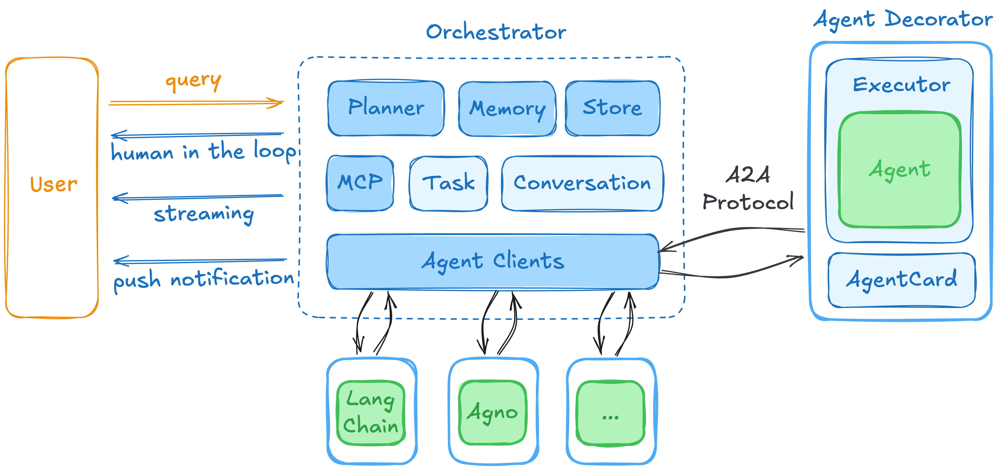

<p align="center">
  
</p>

# QuantCell

QuantCell is a local-first, multi-agent platform for financial research and trading. A team of specialized AI agents helps you research stocks from primary sources, track market news, and run live or simulated crypto trading strategies — while all sensitive data (API keys, conversations, knowledge bases) stays on your device.

> Investing involves risk. QuantCell is a technical project, not financial advice. ⚠️

## Key Features

### Multi-Agent System
- **Research Agent** — retrieves and analyzes SEC filings (10-K, 10-Q, 13F, 8-K) and A-share disclosures, backed by a local LanceDB knowledge base for retrieval-augmented answers with cited sources
- **News Agent** — personalized news retrieval and scheduled delivery to track key information in real time
- **Strategy Agents** — grid and AI-prompt-driven trading strategies, executed live or in paper mode behind the same interface

### Architecture Highlights
- **LangGraph agents** — every LLM agent is a LangGraph state machine: the planner pauses with native `interrupt()` for human-in-the-loop approval and resumes exactly where it stopped, research/news run as ReAct tool loops, and each conversation gets checkpointed memory
- **Agent2Agent (A2A) protocol** — every agent runs as an independent service behind Google's A2A protocol, making agents framework-agnostic and hot-swappable
- **Async orchestration core** — an LLM planner with human-in-the-loop approval gates, hallucination-guarded plan validation against a live agent registry, event-driven task monitoring, and an idempotent SSE streaming pipeline that keeps long-running tasks alive across client disconnects
- **Local-first storage** — SQLite for conversations and tasks, LanceDB for vector search, all in your system application directory

See [docs/CORE_ARCHITECTURE.md](./docs/CORE_ARCHITECTURE.md) for the full design.

### Trading
- **Supported exchanges:** Binance (USDT-M futures) and Coinbase, routed through a unified ccxt execution interface with built-in guardrails
- **Paper trading** — every strategy can run in a risk-free simulated mode behind the exact same execution interface
- Note: trading currently supports contracts only (spot is implemented as 1x contracts); ensure your contract account has sufficient balance, keep your API keys secure, and rotate them regularly

### Flexible Integrations
- **LLM providers:** OpenAI, Google, DeepSeek, Azure, OpenRouter, SiliconFlow, Ollama, and OpenAI-compatible endpoints
- **Market data:** US, crypto, Hong Kong, and China markets

## Quick Start

### Prerequisites
- Python 3.12+ with [uv](https://docs.astral.sh/uv/)
- [Bun](https://bun.sh) for the frontend

### Run the full application (frontend, backend, and agents)

macOS / Linux:
```bash
bash start.sh
```

Windows (PowerShell):
```powershell
.\start.ps1
```

Then open [http://localhost:1420](http://localhost:1420) and configure a model provider in Settings before first use.

### Local data locations

Configuration and data live in your system application directory:
- macOS: `~/Library/Application Support/QuantCell/`
- Linux: `~/.config/quantcell/`
- Windows: `%APPDATA%\QuantCell\`

This contains `.env`, `quantcell.db` (SQLite), `lancedb/` (vectors), and `.knowledge/`. Delete these to start fresh after a long gap between updates.

## Configuration

See [docs/CONFIGURATION_GUIDE.md](./docs/CONFIGURATION_GUIDE.md) for model provider setup, exchange credentials, and agent configuration, and [docs/CORE_ARCHITECTURE.md](./docs/CORE_ARCHITECTURE.md) for how the orchestration core works.

To contribute a new agent, see [docs/CONTRIBUTE_AN_AGENT.md](./docs/CONTRIBUTE_AN_AGENT.md) — an agent is one async generator plus one capability card JSON.

## License

Licensed under the **Apache License 2.0** — see [LICENSE](./LICENSE). See [NOTICE](./NOTICE) for third-party attribution.

Third-party services embedded or integrated (TradingView widgets, exchange APIs, LLM providers) are governed by their own terms.
