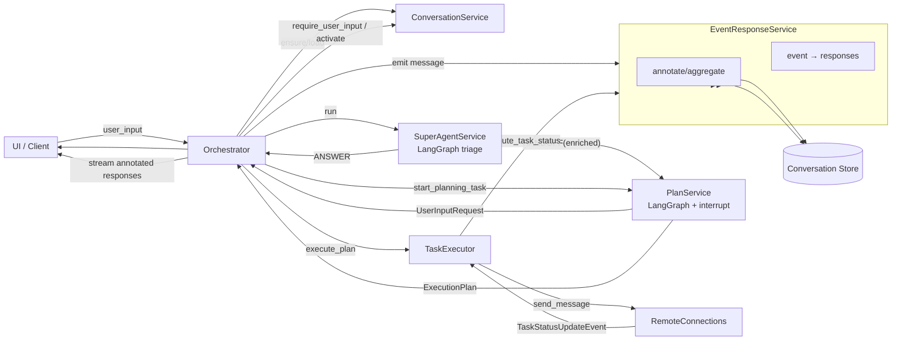
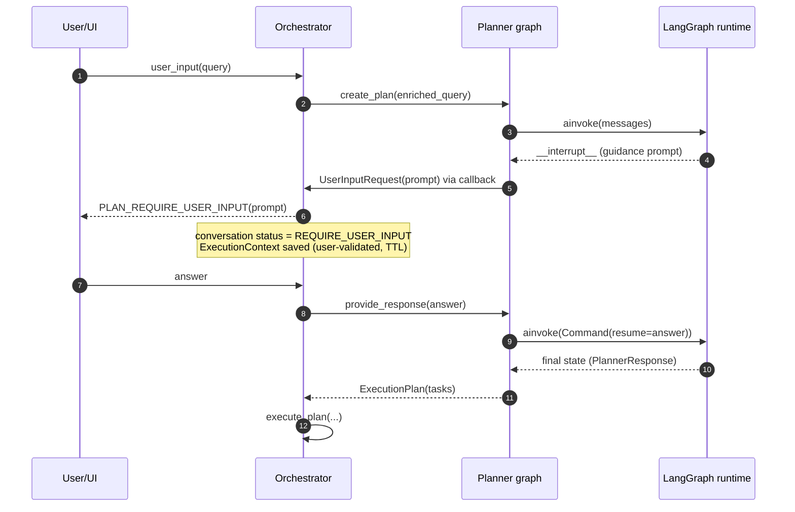

# QuantCell Core Architecture

How the modules under `quantcell/core/` collaborate at runtime, and how the
LangGraph agent layer plugs into the A2A protocol boundary.

## The two-layer design

QuantCell separates orchestration into two layers with different jobs:

- **Macro layer (custom):** the orchestrator's triage → plan → execute → stream
  loop, the Agent2Agent (A2A) protocol boundary that makes every specialist
  agent an independent, swappable service, the typed event pipeline, and the
  SQLite conversation/task stores.
- **Micro layer (LangGraph):** what happens *inside* each agent. The Super
  Agent and Planner are hand-built `StateGraph`s; the Research and News agents
  are prebuilt ReAct agents. Each graph carries per-conversation memory via a
  checkpointer keyed by `thread_id = conversation_id`.

The layers meet at two stable contracts that almost never change:
`BaseAgent.stream()` (an async generator of typed `StreamResponse`s) and the
A2A task lifecycle on the wire.

## Highlights

- **Super Agent triage ahead of planning:** a single-node LangGraph inspects
  every message and either answers directly or hands an enriched query to the
  planner (`SuperAgentOutcome` decision contract).
- **Planner with real human-in-the-loop:** a 3-node graph
  (`generate → validate → clarify`) where `clarify` calls LangGraph
  `interrupt()`. The orchestrator surfaces the prompt, the user's answer
  resumes the graph via `Command(resume=...)`, and clarification rounds are
  capped so an indecisive model cannot loop.
- **Hallucination guard as a graph node:** every planned task's `agent_name`
  is validated against the live agent-card registry before execution; invented
  agents become user guidance, never executed plans.
- **Async, re-entrant orchestrator:** `process_user_input` streams responses
  while a background producer keeps planning/execution alive across client
  disconnects. Planner monitoring is event-driven (an `asyncio.Event` set by
  the user-input callback; no polling).
- **Streaming pipeline:** A2A status events → `ResponseRouter` (typed
  responses) → `ResponseBuffer` (stable item IDs, idempotent aggregation) →
  SQLite store + SSE to the UI.
- **A2A integration:** tasks call remote agents via `a2a-sdk`; agent cards
  double as service discovery and as the planner's capability catalog.

## Services interaction overview

## Request lifecycle

1. **Triage.** The Super Agent graph (`core/super_agent/core.py`) runs once
   per message. Its state is chat history + a parsed `SuperAgentOutcome`;
   streamed tokens surface in the UI as reasoning. `ANSWER` short-circuits the
   whole pipeline; `HANDOFF_TO_PLANNER` forwards an enriched query.
2. **Planning.** `ExecutionPlanner` (`core/plan/planner.py`) drives its graph
   with the live agent catalog rendered into the system prompt (agent cards
   from `RemoteConnections`, no tool round-trips). Output is a typed
   `PlannerResponse` → `ExecutionPlan` of `Task`s (one-shot or scheduled).
3. **Clarification (HITL).** When the planner needs confirmation — schedules
   are the canonical case — the `clarify` node interrupts. `create_plan`
   wraps the prompt in a `UserInputRequest` (asyncio.Event), the orchestrator
   flips the conversation to `REQUIRE_USER_INPUT`, and the user's next message
   resumes the checkpointed graph exactly where it paused.
4. **Execution.** `TaskExecutor` (`core/task/executor.py`) acquires an A2A
   client per task, sends the query with injected dependencies (user profile,
   language, timezone), and consumes the remote agent's streaming task-status
   events. Scheduled tasks re-run on their configured cadence with results
   accumulated into summary components.
5. **Streaming & persistence.** Every event is routed, annotated with stable
   item IDs, persisted, and streamed. Disconnects don't stop execution; the
   UI replays from the store on reconnect.

### Sequence: planning with interrupt-based HITL

## The agent layer

Every specialist agent is an independent A2A server built from two pieces:

- a class implementing `BaseAgent.stream()` — internally a LangGraph
  (`create_react_agent` for tool-using agents), streamed through the shared
  adapter `agents/utils/langgraph_stream.py`, which maps LangGraph message
  events onto `streaming.message_chunk` / `tool_call_started` /
  `tool_call_completed` / `done()`;
- a JSON **agent card** in `configs/agent_cards/` declaring name, URL, and
  skills. The card is served over A2A for discovery *and* rendered into the
  planner's prompt as its capability catalog — one source of truth for both.

`core/agent/decorator.py` wraps the class in a full A2A server
(`A2AStarletteApplication` + uvicorn); `core/agent/client.py` is the calling
side. Adding an agent means writing one async generator and one JSON file.

Current specialists: **ResearchAgent** (SEC/EDGAR + A-share filings, web
search, crypto data, and a LanceDB-backed `search_knowledge_base` tool that is
attached only when embeddings are configured — otherwise the agent degrades
gracefully to tools-only mode), **NewsAgent** (news retrieval, scheduled
digests), and the **strategy agents** (grid and prompt-based trading over the
shared trading library, live on Binance/Coinbase or paper mode behind one
execution interface).

## Models and providers

`adapters/models/langchain_factory.py` builds LangChain chat models and
embeddings for nine providers (OpenAI, Google, Azure, Ollama, and five
OpenAI-compatible endpoints) from a three-tier configuration (YAML < .env <
environment). Per-agent YAML selects each agent's model; unavailable providers
fall back to the primary with per-provider model mappings honored.

## Error handling & resilience

- Missing parameters → HITL clarification (capped rounds)
- Malformed model output → typed guidance/fallback outcomes, never crashes
- Hallucinated agent names → plan rejected with user guidance
- Agent failures → typed `FAIL_TASK` side effects persisted to the task store
- Invalid or expired execution contexts (1h TTL, user-validated) → safe cancel
- Client disconnects → background producer continues; store holds the truth

## Extensibility

- **New agent:** async generator + agent card JSON (see
  [CONTRIBUTE_AN_AGENT.md](./CONTRIBUTE_AN_AGENT.md))
- **New provider:** one builder function in the LangChain factory registry
- **New store:** implement the `ItemStore`/`ConversationStore` interfaces
- **Different HITL policy:** adjust the planner graph's `clarify` routing

In short: LangGraph runs the reasoning inside each agent; the custom
orchestrator and the A2A protocol run the collaboration between them. The
seam between the two — `BaseAgent.stream()` and agent cards — is what keeps
every part independently replaceable.
